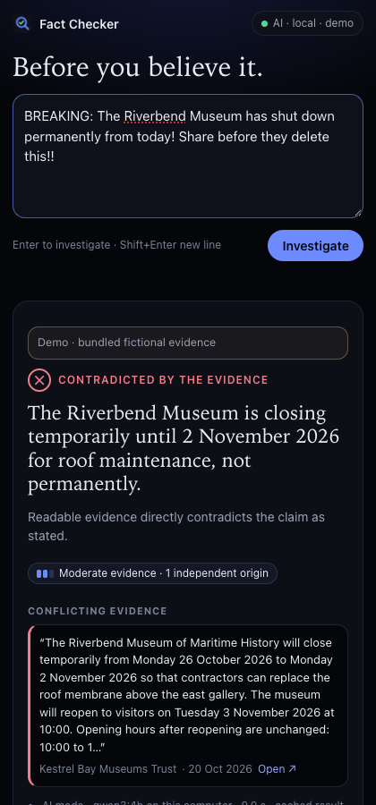
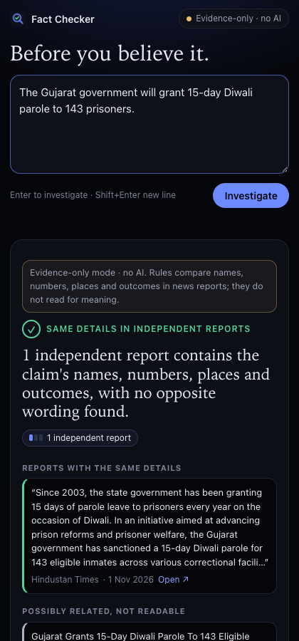
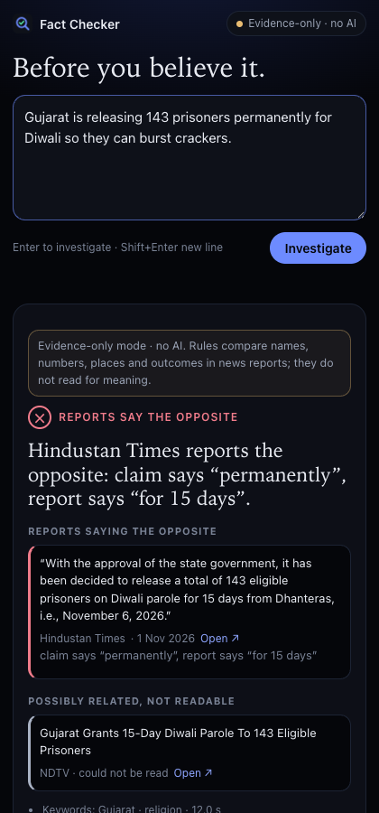

# Fact Checker — Chrome extension

Right-click any text → **Fact-check "…"**. The side panel checks it against the news.

| AI · local | No AI: same details | No AI: says the opposite |
|---|---|---|
|  |  |  |

Step-by-step install with screenshots: [main README → Add the extension to Chrome](../README.md#add-the-extension-to-chrome-local-install).

## Two modes, chosen automatically

| | **AI · local** (A) | **Evidence-only · no AI** (C) |
|---|---|---|
| When | The Fact Checker app is running (`./run.sh`) with its model | Otherwise, or if you choose it in the panel |
| Who decides | The app's full pipeline + local Ollama model + validators | Fixed rules in the extension |
| Labels | Supported / Contradicted / Misleading / Not enough evidence / … with evidence strength | Same details in independent reports / Reports say the opposite / Same topic — read carefully / Reports differ on details / Reports mention a denial / Reports conflict / A fact-checker disputes a similar claim / No matching coverage found |
| Your claim goes to | Only the app on this computer (`127.0.0.1`) | Nowhere. The extension downloads public news feeds and articles to compare locally |

Evidence-only mode reuses the app's own checks:
- keyword and topic routing to city and topic feeds;
- grouping copies of the same story;
- key-term coverage;
- **exact numbers and places** (localities count, so Wakad is in Pune);
- outcome words (acquitted, died, arrested…);
- denial wording;
- published fact-checks (Alt News, FactCheck.org).

They also detect **opposites**:
- negation: "*not* closing permanently";
- listed antonym pairs: temporary ↔ permanent, below the limit ↔ dangerous, rose ↔ fell,
  won ↔ lost, interim bail ↔ acquitted…;
- a stated price against a claim of "free";
- hedged wording ("some think it may…");
- reports that are too old or undated for a "today" claim.

Each of these names the conflicting words, so you can check it in seconds. Rules still cannot
read for meaning, so they never say "true" or "false". If a matching report can't be read, it searches for the same story
elsewhere. Missing coverage is never treated as falsehood.

## Where evidence-only mode looks

| Source | Coverage | How |
|---|---|---|
| **Local news index** | 55 feeds (14 general + 41 city/topic), **up to 14 days**, ≤ 40,000 headlines | The background worker refreshes all feeds every 30 minutes while Chrome is open (≈ 2 s) and stores headlines in IndexedDB on your computer |
| Fresh pull | The general feeds + up to 6 feeds matching the claim's places/topics | Fetched at check time, so the last few minutes are included |
| Article pages | ≤ 5 per check (+3 when following a blocked story, +3 from GDELT) | Read directly from the publisher |
| **GDELT** | Worldwide news, **≈ 3 months** | Queried in parallel; used when the local index finds fewer than two readable reports. Slow, and sometimes it doesn't answer |
| **Wikipedia** | Background on people, places, organisations | Shown as *Encyclopedia background (not news)*; never produces a green label |
| Fact-checks | Alt News, FactCheck.org | From their feeds |

The index starts with whatever the feeds list on the day you install it. Some feeds reach back
weeks, the busiest city feeds only hours. It grows to a full 14 days after two weeks of Chrome
running. See its status, or **Update now**, by clicking the mode chip.

**Reading articles GDELT finds on other sites** needs an extra permission. It is off by default.
Turn on *Read articles from any news site* in the panel settings, and Chrome asks you to confirm.
Without it, those reports are listed as links.

## Install (developer mode)

```bash
npm run build:extension
```

1. Open `chrome://extensions` and turn on **Developer mode**.
2. Click **Load unpacked** and choose `extension/dist`.
3. Pin **Fact Checker**. Click it to open the side panel, or select text on any page and
   right-click → **Fact-check "…"**.

For AI mode, run the app with `./run.sh`. The panel's mode chip turns green (**AI · local**).
If the app runs at a different address, change it in the panel (click the mode chip).

## Privacy and permissions

- **Permissions:** `contextMenus`, `sidePanel`, `storage`, `alarms` (the 30-minute index refresh). Host access is limited to the news
  publishers in the feed lists (derived from `app.config.ts` at build time) and the local app.
  Also GDELT and Wikipedia's APIs. Reading *any* news site is an optional permission you
  grant in settings. There's no access to your browsing history.
- **Selection:** the selected text stays in the extension's session storage until you check it.
- **Storage:** your settings, a 20-minute feed cache, and the 14-day headline index
  (≤ 40,000 headlines, about 10–15 MB). Remove the extension to delete it all.
- **App access:** the app accepts calls only from this extension's fixed ID
  (`jkccdjdinghdfoampelfceigjgkbkdfi`, set by the public key in the manifest). A Web Store build
  would get a different ID; add it with `FACTCHECK_EXTENSION_ORIGINS`.

## Tests

`tests/unit/extension-rules.test.ts` covers the rule engine. `tests/e2e/extension.spec.ts`
loads the unpacked extension in Chromium and tests:
- its stable ID;
- AI mode against the app;
- fallback to evidence-only mode with live feeds;
- the right-click handoff.
